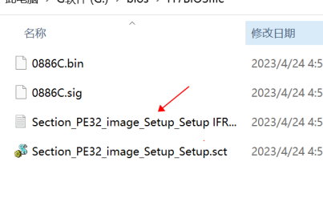
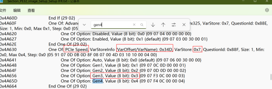
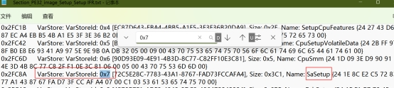

+++
date = '2026-08-08T11:30:09+08:00'
draft = false
title = 'hp omen 台式外接显卡延长线升级bios注意事项'

+++

1：下载好对应序列号版本的bios文件，我的SSID是886C


2：直接安装.exe到c盘，安装完后会自动弹出程序界面，选择1直接update，程序会自动在启动盘创建好efi开机引导程序，直接重启后可以自动升级


3：由于是z590主板，是pcie4.0，而我用的是pcie3.0的延长线外接的显卡，所以刷完bios后，需要把pcie speed从gen4或者auto（默认）改为gen3


由于hp的bios是封闭式，在官方bios config里面是没有修改的地方，需要从2那里选择3把刷机的bin文件解包出来，然后用专用工具提取出PE32文件





0x7对应是在这个项目里面Sastep



里面就是bios的config了，搜索“pcie speed”会发现有4个值

0x34D、**0x34E(我后来用排除法确定这个值是对应我显卡pcie x16那个插槽)**、0x34F、0x350都是有auto，gen1-gen4的，这里其中一个对应的显卡pciex16的插槽，另外3个值则是属于PCH

````mermaid
graph TD;
PCH-->pciex1短插槽0x34D假设;
PCH-->主板上另外两个M.2固态位0x34f和0x350;
````

## 四条通道分别改动后的后果

1. **0x34E（CPU‑X16 显卡插槽）**

   正是你需要的，强制 Gen3，适配你的 Gen3 显卡延长线，3090 完美点亮；显卡游戏性能损失仅有 1‑3%，日常完全感知不到差距。（如果不改，原来默认是auto，gen4卡从gen3，会黑屏）

2. **0x34D（PCH 南桥 X1 插槽）**

   Z590 南桥通道**原生最高只能跑 PCIe3.0**，就算 Auto 模式也跑不到 4.0。你手动改成 Gen3 等于维持原有规格，**无线网卡、声卡、拓展卡零影响**。

3. **0x34F、0x350（两条 M.2 固态通道）**

- 其中一条是**CPU 直连 M.2（原生 PCIe4.0）**：如果你装了高端 4.0 固态（980Pro、SN850 这类 7000MB/s 级别），会被强制锁在 PCIe3.0，顺序读写上限从 7000MB/s 降到 3500MB/s，速度腰斩；
- 另一条是**PCH 南桥 M.2**：出厂天生就是 Gen3，修改参数没有任何变化。


所以找出了0x34E后，只改他即可，值从来的00改为03即可；这个需要提前准备好，因为刷完bios后，原来的显示器接rtx3090不会亮屏，这时候可以用usb采集卡外接安卓手机来显示修改bios或者把dp从3090拔下转接到3080显卡上也能点亮（我机器的pcie x1插槽有转usb-riser x1）

------

### 附上RU.EXE修改方法

1：首先进到ru界面，会有个欢迎界面，按“空格”跳过

2：然后按 alt和=键进入，bios功能菜单

3：功能菜单翻页是page down键和page up键

4：找到确定的功能值后，按enter进入到功能修改界面，这个界面下项目值的翻页是ctrl+page down/up

5：项目值的修改是根据记录好的地址值VarStoreInfo (VarOffset/VarName)定位到修改的项目，然后按enter键，然后直接输入要修改的值，修改好之后再按一下enter。

6：所有的项目都修改好，最后CTRL+W，写入保存！

7：然后alt+q，退出ru

8：然后返回efi，halt关机，然后再重新开机即可

------

HP的bios里面的advance那里的内存超频尽量不要动，这里有个很坑的BUG，你一点进入那里，切换了设置，哪怕最后不保存，也到导致内存的超频参数全部变更，像我这种插满4根内存条的情况，动了变更，很可能会导致白屏，只能拆机清CMOS
