+++
date = '2026-11-08T11:40:57+08:00'
draft = false
title = 'win引导全解'

+++

# 一：原理与关系诠释

***\*UEFI 和 Legacy 是主板的两种“底层引导模式”\****，它们决定了主板开机后如何识别硬盘并启动操作系统。

UEFI 与 Legacy 的核心区别

可以用**老式按键机**与**现代智能机**来类比它们：

| 特性                 | Legacy (传统模式)                                            | UEFI (现代模式)                                              |
| -------------------- | ------------------------------------------------------------ | ------------------------------------------------------------ |
| **画面与操作**       | 只能显示蓝底白字的简陋 BIOS 界面，只能用键盘操作。           | 支持高清图形界面，支持**鼠标点击**，甚至支持中文。           |
| **开机速度**         | **慢**。开机要逐个自检所有硬件，耗时长。                     | **快**。支持“秒级”快启，自检与系统引导同步进行。             |
| **搭配的硬盘分区表** | 必须搭配 **MBR** 格式（最大仅支持 2TB 硬盘，最多 4 个主分区）。 | 必须搭配 **GPT** 格式（支持 2TB 以上大硬盘，分区数量几乎无限制）。 |
| **安全机制**         | 没有安全验证，容易在开机前被引导区病毒拦截。                 | 带有 **Secure Boot（安全启动）**，防止恶意软件篡改引导。     |

**EFI 是“硬件和主板层面的规范”，而 BCD 是“Windows 操作系统层面的菜单配置数据库”。** 在现代电脑中，它们是**上下级合作关系**。

[开机] -> 1. 主板加载 UEFI 固件 -> 2. 固件读取硬盘的 ESP 隐藏分区 -> 3. 执行微软的引导程序 (bootmgfw.efi) -> 4. 该程序读取 BCD 菜单 -> 5. 屏幕显示系统选择列表 -> [进入 PE/Windows]

因此利用 BCD 引导硬盘的 PE是最安全的，哪怕引导失败，也完全不用担心无法进原系统

**`bootx64.efi` 是 UEFI 规范定义的“万能默认路标”，而 `bootmgfw.efi` 是微软 Windows 专属的“当家大堂经理”。**

------

1. 核心定义与区别

| 特性         | bootx64.efi (默认引导文件)                           | bootmgfw.efi (Windows 引导管理器)                   |
| ------------ | ---------------------------------------------------- | --------------------------------------------------- |
| **属于谁**   | **UEFI 国际标准规范**（任何系统通用的命名规则）。    | **微软 Windows 系统专属**（Windows Boot Manager）。 |
| **存放路径** | 固定的默认路径：`\EFI\Boot\bootx64.efi`              | 微软专属路径：`\EFI\Microsoft\Boot\bootmgfw.efi`    |
| **主要职责** | 当主板不知道该启动谁时，作为**最后的保底备用路标**。 | 负责**读取 BCD 菜单**，正式拉起 Windows 或 PE。     |
| **常见场景** | **U 盘启动盘**、光盘、或者是刚格式化完的空白硬盘。   | 已经安装好 Windows 的**本地电脑**                   |

在微软的体系下，**这两个文件在代码层面上其实是“双胞胎”，甚至是一模一样的同一个文件。但可以用第三方的bootx64.efi 替代掉微软那个做成efi万能引导**

# 二：制作自定义引导PE

①bcd引导法，直接用本地硬盘启动PE进ramos

打开BOOTICE，按下面操作添加PE

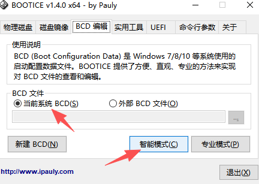

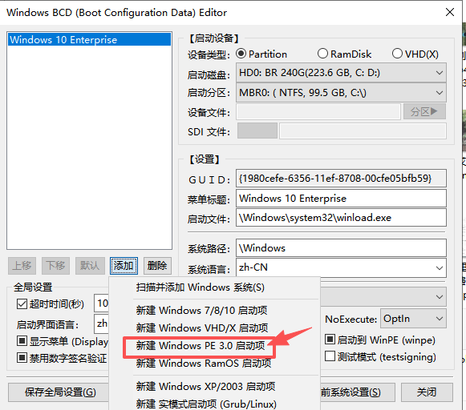

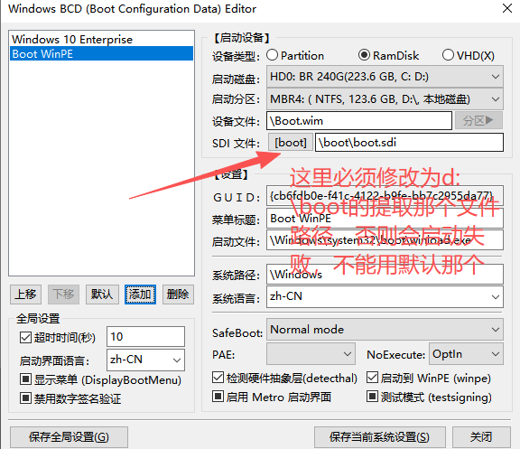

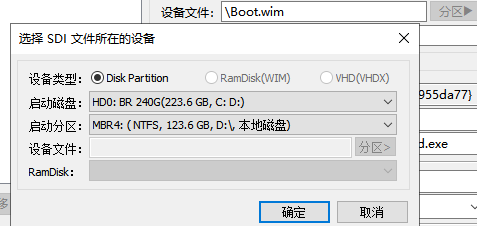

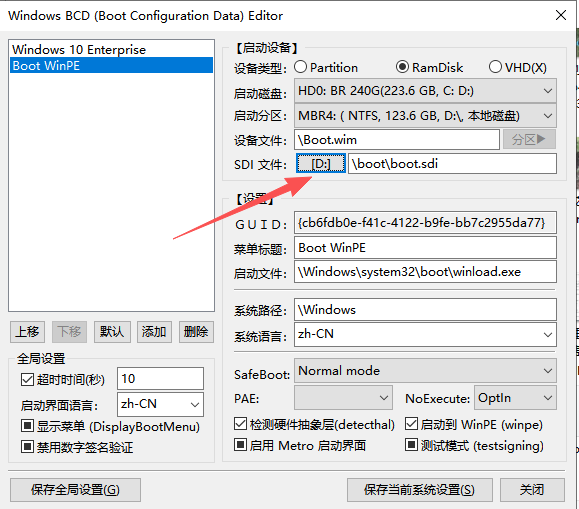

注意，上面的wim和sdi文件是直接从下载好的win10pe.iso文件装载后复制出来的，wim放D根目录，sdi需要放到d:\boot目录，添加好修改一下时间10s，其他地方不需要改动，默认即可，最后保存即可

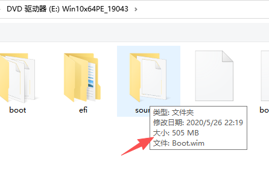

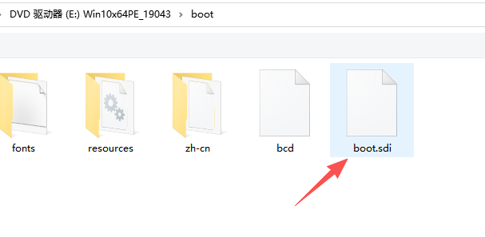

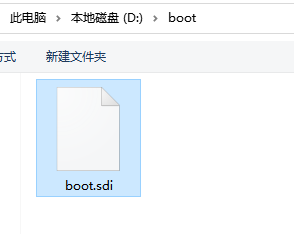

②UEFI模式（需要主板支持，旧的Legacy 模式主板，用boottice启动会这样）

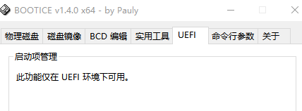

支持uefi的主板，直接点击修改启动序列，添加7mb那个bootx64.efi

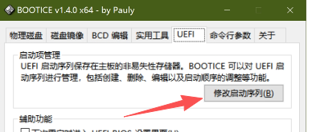

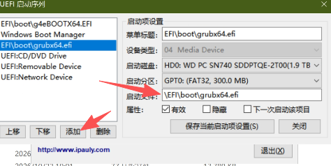

可以直接复制过去替换掉原来微信那个，然后上面添加指定，再设置为第一启动序列即可，这里的设置等同于进bios设置启动顺序

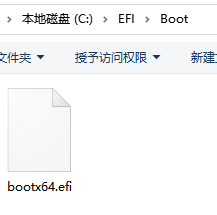

# 三，其他第三方引导

如Grub4dos、g4ebootx64.efi、grubx64.efi，都属于 **第三方开源引导工具（GRUB 家族及其衍生版）**。它们最大的特点是**定制性极强、功能极度恐怖**

（比如可以直接在开机时强行挂载并运行本地的 `.iso`、`.img` 甚至软盘镜像），这是微软自带的 BCD 引导绝对做不到的。做ramos目前最好的是g4ebootx64.efi

区别一览

| 引导文件名/工具    | 服务的底层环境        | 它的本质与核心定位                                           | 最大的绝活/特点                                              |
| ------------------ | --------------------- | ------------------------------------------------------------ | ------------------------------------------------------------ |
| **Grub4dos**       | **Legacy / MBR**      | 基于经典 GRUB 改造的 **传统模式超级引导工具**。              | 可以在不解压的前提下，直接**仿真（Map）并启动本地的 `.iso` 镜像**。 |
| **g4ebootx64.efi** | **UEFI / GPT** (64位) | **Grub4dos 的 UEFI 现代移植版**（官方命名为 Grub4dos for UEFI）。 | 继承了传统 Grub4dos 的直接加载 ISO 能力，但**完美支持 UEFI 环境**。 |
| **grubx64.efi**    | **UEFI / GPT** (64位) | **GRUB2（标准第二代 Linux 引导）**的编译生成文件。           | **Linux 系统的标准御用引导**（如 Ubuntu），通常负责引导多系统。 |
