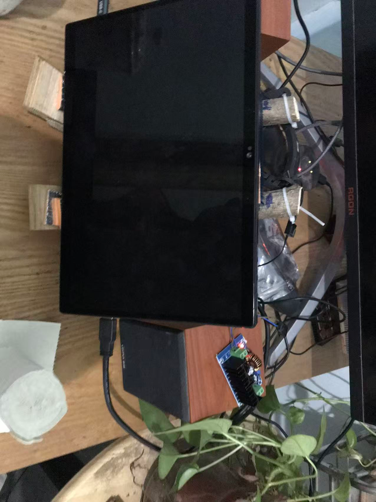
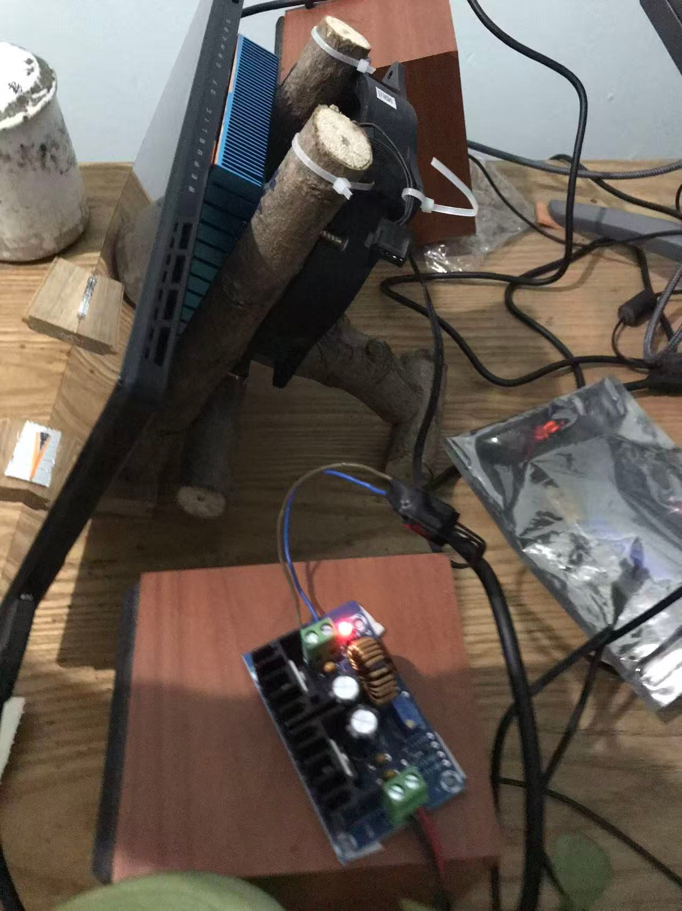
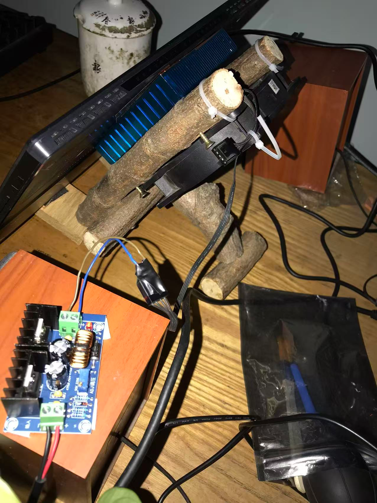
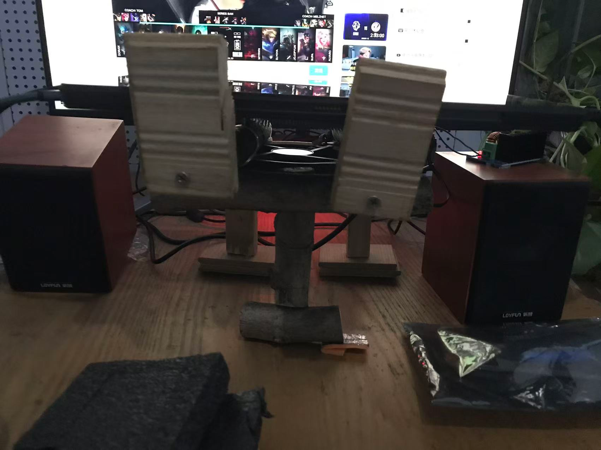

+++
date = '2026-10-30T17:51:47+08:00'
draft = false
title = '一根被台风打断的木头如何活出第二世'

+++

DIY木工，可以根据自己的需求很灵活手搓出来，如之前木地板用剩下的料手搓了两个机架，怒剩几百

刚好幻x缺个散热支架，刚好前段时间捡了一根废弃的木条，一翻捣鼓，就有了下面这个幻x的多功能二合一分体散热支架

后面这个支撑是在待机平放时候用的，平躺液金回流？
