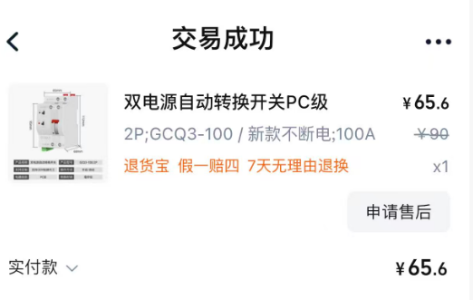
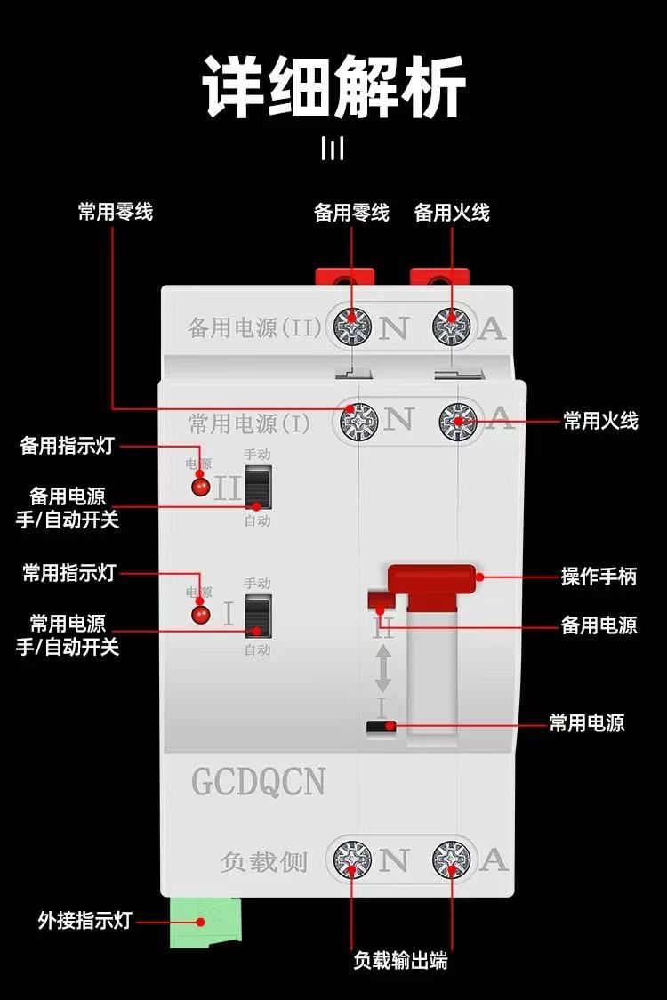
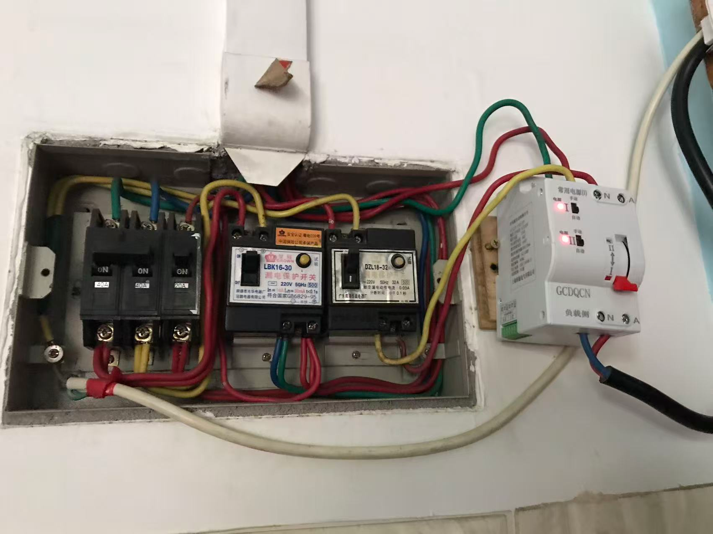
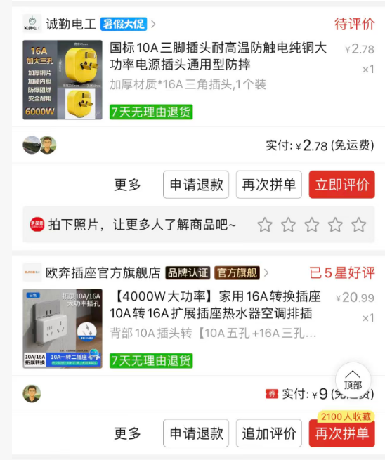
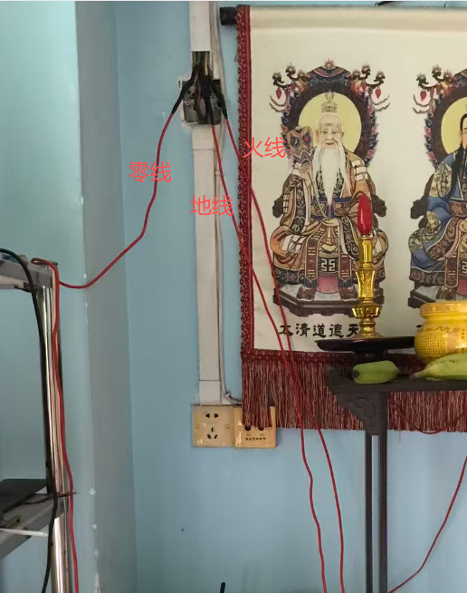
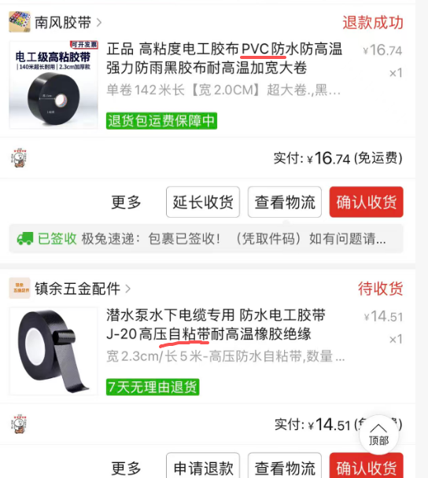

+++
date = '2026-07-07T16:24:26+08:00'
draft = false
title = '家庭服务器ATS-ups方案'

+++

突然断电，对于正在运行的PC来说是灾难级的，我的一块4T机械硬盘就是这样毁了；考虑买UPS的时候，突然联想到家里有套现成的光伏系统（主要是有块12v300ah的磷酸铁锂电瓶），是否可以利用起来，剩下UPS的钱，于是把我现在的设备情况和需求咨询了GPT，结果得到一个全新的方案——ATS

UPS简单说，就是相当于手机（PC）的电池，市电先充UPS，然后UPS供电给PC；而ATS则是一个双电源的切换开关（pc级的ats一般都是30ms左右，基本不会关机，切换期间电容能顶住！）

这样一来，通过一个ATS开关，就能把现在的太阳能系统（电池）作为PC的应急备用电源了，一旦停电可以实现自动切换，然后PC端运行了一个ps脚本，检测到网卡断开马上杀掉所有耗电进程，持续断网3分钟自动关机，这样可以避免路由器重启误判（主要是我太阳能系统购买的所谓5000w逆变器太垃圾，不能让它长时间高负荷运行）

逆变器买一个10a一分二的插头，如上图4000w的，这样可以实现不影响现有的太阳能输出负载，并联一路16a的线路作为ats的备用电源给pc应急就行

另外改装家庭配电箱和电路一定要注意安全，确保所有操作均在完全断电的情况下，用万用表测得0v的状态下进行作业！

为了少折腾，不重新布线，我直接舍弃掉了一个插座，利用原有的6方BV线路，直接把逆变器出来的线接上去的

黑色连接点那里，一定要做好绝缘，我是用了3层胶带

1，热缩套

2，**橡胶自粘带**打底

3，外层**PVC胶带**绝缘防护

