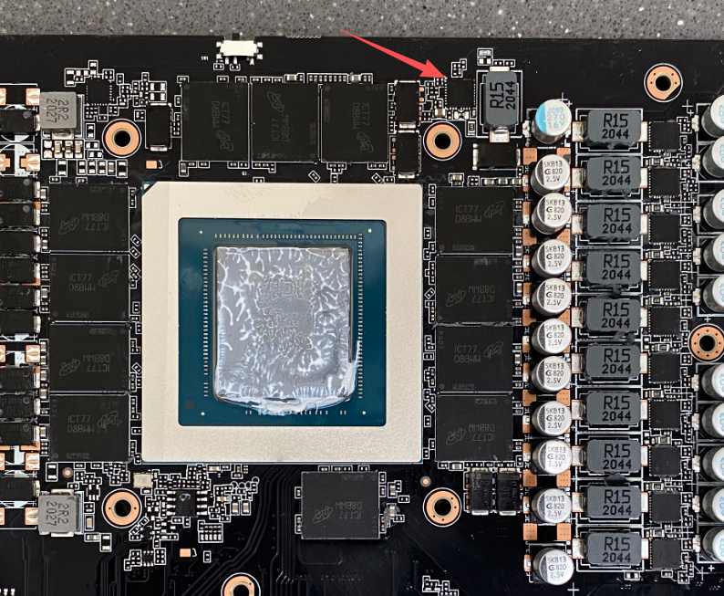
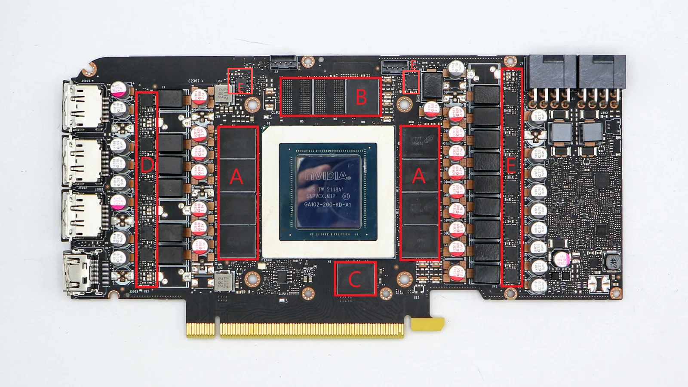

+++
date = '2026-07-24T11:45:15+08:00'
draft = false
title = '显卡散热改装方案'
+++

显卡散热改装方案


主要发热元器件：核心，闪存，VMOS


核心：直接用20*35mm规格的一块7950相变片即可（相比7868硅脂，更持久！不二次打开，基本可以用到显卡报废）


闪存和和vmos：用0.5mm规格的莱尔德9w进行打底和给铜片做绝缘防护，然后根据具体型号的显卡原来导热垫的厚度选择好合适厚度的铜片

| RTX 3090 Founders Edition   | 1.5mm | 1.5mm                 |
| --------------------------- | ----- | --------------------- |
| Gigabyte RTX 3090 Vision OC | 2.0mm | 2.0mm                 |
| Gigabyte RTX 3090 Eagle OC  | 2.0mm | 2.0mm                 |
| ASUS RTX 3090 ROG Strix     | 1.5mm | 1.5mm                 |
| ASUS RTX 3090 TUF           | 1.5mm | 2.0mm or 2.5mm (软质) |
| MSI RTX 3090 Ventus 3X      | 2.0mm | 2.0mm                 |
| HP Omen RTX 3090 OEM        | 1.0mm | 1.0mm                 |

原来是2mm厚度的，就用7868硅脂+1.5mm铜片+0.5mm莱尔德9w

**方案A：**

```
散热器
│
2mm 莱尔德9W
│
GDDR6X
```

**方案B：**

```
散热器
│
7868（极薄）
│
1.5mm 紫铜片
│
0.5mm 莱尔德9W
│
GDDR6X
```

## 理论热阻比较

只计算材料本身热阻（单位面积）：

### 方案A

导热垫：

- 厚度：2mm
- 导热率：9W/m·K

热阻：

```
2 / 9 = 0.222
```

------

### 方案B

导热垫：

```
0.5 / 9 = 0.0556
```

铜片：

```
1.5 / 400 = 0.00375
```

7868：

只有几十微米厚，可以近似忽略。

总热阻：

```
≈0.059
```

也就是说：

| 方案                 | 相对热阻 |
| -------------------- | -------- |
| 2mm 莱尔德9W         | 0.222    |
| 0.5mm 莱尔德+1.5mm铜 | 0.059    |

理论上：

**方案B热阻约只有方案A的1/3～1/4。**

**魔鹰和MSI万图师3080一套改下来温度直接爆降30多度！**

**对于1mm厚度的情况一套改下来，温度降低10多度**

#### 方案1

```
散热器
│
1mm 莱尔德9W
│
显存
```

导热路径：

```
1mm 导热垫
```

------

#### 方案2

```
散热器
│
7868
│
0.5mm 铜片
│
0.5mm 莱尔德9W
│
显存
```

导热路径：

```
0.5mm 导热垫
+
0.5mm 铜片
+
极薄7868
```

可以简单估算热阻（不考虑接触热阻）：

- **方案1：**

  - 1 mm / 9 W/m·K ≈ **0.111（相对值）**

- **方案2：**

  - 0.5 mm / 9 ≈ **0.056**

  - 0.5 mm / 400 ≈ **0.0013**

  - 一层极薄7868的热阻通常远小于0.5 mm导热垫产生的热阻。

  - 总热阻约：

    ```
    ≈0.057
    ```

因此方案2的总体热阻仍明显低于方案1。

对于vmos也是同理，不过vmos由于是一排的，可以直接用一整条紫铜条片，厚度和宽度根据收集到的具体显卡型号确定，一般宽度在6~8mm都很稳

另外实际操作中发现0.5mm厚度的铜片铜条，直接用剪刀可以直接剪裁，然后毛刺的地方，需要打磨，弯曲的也需要用钳子压平整

对于vmos管，我发现很多丐版的3080，3090显卡，核心侧左右上角（E）的一颗vmos管，厂商居然没有自带导热垫，统计了很多维修视频都是因为这颗vmos炸了，直接把显存和核心一套带走的案例实在是太多！！严重怀疑是厂商故意的（计划性报废)





主要负责给核心和显存供电的，一旦炸了，核心基本GG
