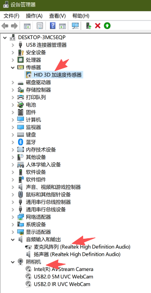
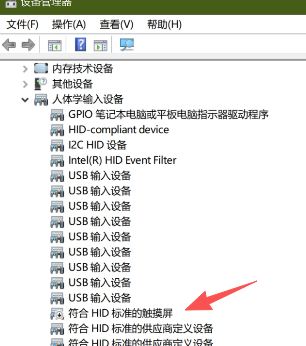
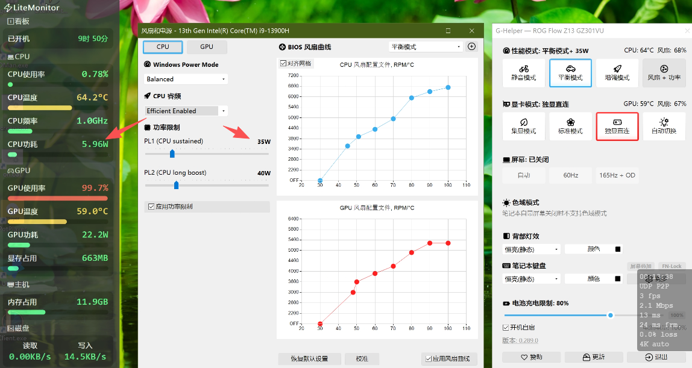
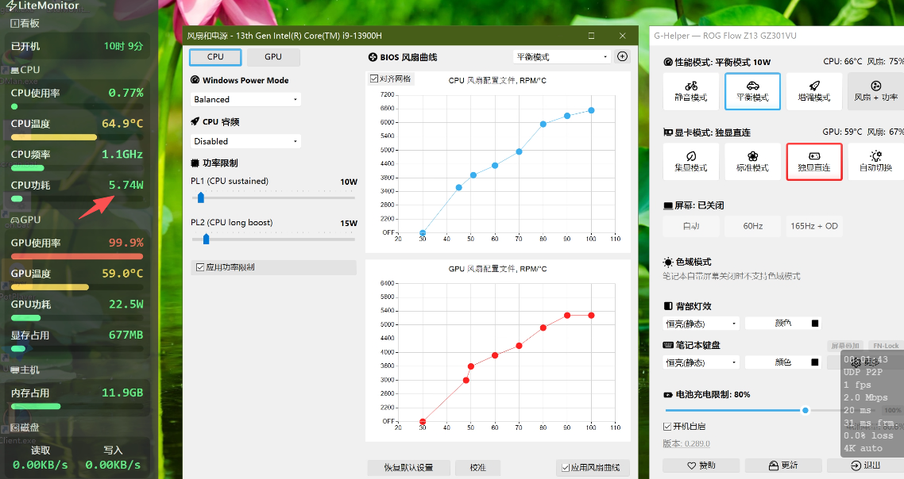

+++
date = '2026-10-26T11:43:53+08:00'
draft = false
title = '电子设备省电设置通用版'

+++

一：现在的电子设备，如pc，mobile越来越强大，功能越来越大，有些时候暂时用不掉那么多功能，其实可以通过禁用，来让其暂时停止工作，断开和cpu的通信，从而节省cpu的功耗而达到省电的目的，以幻x2023为例

HID是陀螺仪，麦克风，摄像头，触摸屏，我平时用不到，就可以在设备管理器上禁用掉，等需要用的时候再启用，这样也能节省不少电，延长续航，提升流畅度

二：关于cpu功耗，限制与调度

各种调度模式对比

| 模式名称                                | 核心行为与区别                                               | 适用场景                                               |
| --------------------------------------- | ------------------------------------------------------------ | ------------------------------------------------------ |
| **Disabled** (已停用)                   | **完全关闭睿频加速。** CPU 严格限制在基础频率（Base Clock）以下运行。能大幅斩断瞬时功耗和发热，但会牺牲短时间高负载的爆发性能。 | **极致省电与控温**（如纯看网页、文书工作、掌机挂机）。 |
| **Enabled** (已启用)                    | **默认平衡模式。** 根据系统负载机会性地提升频率，在响应速度、发热量和能耗之间取得原生平衡。 | 日常综合使用。                                         |
| **Aggressive** (激进)                   | **性能优先。** 只要有负载，CPU 就会以最快速度冲向最高睿频、并尽可能长地维持高频。即使系统在轻度活动，也会导致高功耗与风扇高转速。 | 游戏、大型编译、3D 渲染。                              |
| **Efficient Enabled** (高效启用)        | **能效优先的睿频。** 允许 CPU 睿频，但 Windows 会对“能效比”进行严格评估，只有在硬件能高效完成时才允许冲高频，避免无谓的功耗浪涌。 | **兼顾流畅度的省电**（笔记本不插电移动办公首选）。     |
| **Efficient Aggressive** (高效激进)     | **混合折中模式。** 依然追求高响应速度和快速提频（Aggressive），但引入了能效评估，在低负载或高频边际效应严重时更严厉地限制功耗。 | 想要保留游戏/大应用响应，又想稍微控温的场景。          |
| **Aggressive at Guaranteed** (保障激进) | 类似于 Aggressive，但参考硬件的“保底持续性能线（Guaranteed）”算力，直接向处理器索要高于保底线的最高目标频率。 | 拥有极佳散热的大型台式机。                             |
| **Efficient at Guaranteed** (保障高效)  | 在确保 CPU 维持在保底基础性能（Guaranteed）的范围内，以能效和省电作为第一优先级调度频率。 | 兼顾基准性能与能效。                                   |

哪种能耗最优？（如何选择）

根据你的实际需求，有两种“能耗最优”的解法：

1. **绝对能耗最低（极限省电、完全不发热）：选择 `Disabled`**
   - **原理**：直接封印了高频状态。测试表明，笔记本在纯网页和文字办公时关闭睿频，最高可减少 **30%~40% 的电池消耗**，且电脑基本不会发热或发出风扇噪音。
   - **缺点**：解压大文件、打开重度软件时会感觉变慢。
2. **日常体验能耗最优（兼顾流畅度与省电）：选择 `Efficient Enabled`**
   - **原理**：这是智能化程度最高的节能模式。系统会阻止 CPU 因为频繁的弹窗或后台小动作而盲目“冲高频”，只在真正需要算力的时候高效睿频。在不卡顿的前提下，达到了最佳的能效比。

- **限制功耗浪涌**：CPU 默认的瞬时睿频功耗（PL2）非常高。勾选它，意味着**你获得了手动锁死 CPU/GPU 瓦数（W）的权限**，能够强行把功耗压在极低的范围内。
- **物理级省电**：相比于调整系统策略，直接限制硬件功耗（例如把 CPU 限制在 10W）是**最简单粗暴、也最有效的省电控温手段**。

- **CPU Sustained (PL1 - 持续功耗)**：调至 **10W**
  - *作用*：限制 CPU 长时间运行（如持续看网页、开多个文档）时的最高功耗。10W 足够
- **CPU Long Boost (PL2 - 长时间睿频功耗)**：调至 **15W**
  - *作用*：允许 CPU 在突然打开重度软件或解压文件时，瞬间爆发出短暂的高算力，避免系统卡顿，5-10 秒后会自动落回 10W。

注意这里PL1设置了35w不是说cpu日常运行就会在这个功耗上，而是上限锁定在35w~40w，待机时功耗还是在5~6w这样的，可以看到上图对比，两中设置，在实际待机负载下基本是一样

​	针对我自己的使用场景

​	待机时设置PL1:10，PL2:15

​	使用时设置PL1:30~35，PL2:35~40足矣

对于换x2023，i9-13900H这种限制了超频降压的cpu，装了g-helper后就不用再装ThrottleStop（实测这颗U无法FIVE降压，有BIOS锁）了，避免两者互相抢调度打架
