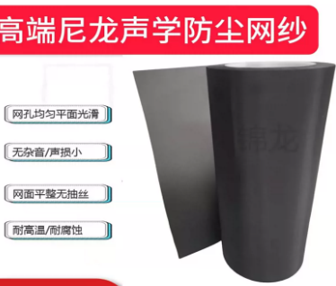
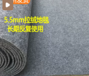

+++
date = '2026-07-23T15:25:01+08:00'
draft = false
title = '自制家庭服务器机架防尘罩方案'

+++

生物箱，死贵，而且还需要单独的进风和抽风两台风机，抽风机侧还要加过滤棉；思来想去，发现性价比最高的方案是，直接把整个房间作为生物箱，门作为进出风口，增加过滤网就行，利用自然风进行热交换

门处用两层网，一层是蚊帐（32-40目，隔绝大灰尘和蚊虫）二层之前是用无纺布，实测效果不好，一来是大风不起作用，二来是不耐用，现在测试

**80～100 目尼龙防尘网（黑色更好）**

**推荐 80-120 目左右的尼龙网，最佳平衡是 100 目左右。**

### 为什么选这个目数？

- **目数越高**，网孔越小（防尘越好），但**通风阻力越大**（影响散热）。
- **目数越低**，通风好，但大颗粒灰尘容易通过。

#### 常见目数对应孔径（近似值）：

- **40-60 目**：孔径 ~0.25-0.4mm，通风优秀，但防尘一般（适合对灰尘不敏感的环境）。
- **80-100 目**：孔径 ~0.15-0.2mm，**最推荐的平衡点**。能挡住大多数可见灰尘、毛发、宠物毛等，同时通风阻力可接受。
- **120-160 目**：孔径 ~0.1-0.125mm，防尘效果更好（挡细小浮尘），但通风会明显变差，有些人反馈“会挡风”，需要更频繁清洗。

电脑机箱防尘主要对付**可见灰尘 + 毛发 + 部分 PM2.5 级浮尘**，不需要像工业过滤那么细。很多商业尼龙防尘滤网（包括知名品牌）都采用类似规格，实际使用反馈良好，不会明显导致温度升高

然后对于极细小的灰尘吸附，必须在机架的底部铺一层地毯！（圈丝地垫地毯最好，但太贵；其次是工业短毛针刺地毯 / 展览地毯，性价比很高，吸尘同时还能防潮）

如果还需要进一步防尘防护，可以做一个木架，罩上蚊帐，实测40目的蚊帐完全不会影响散热
