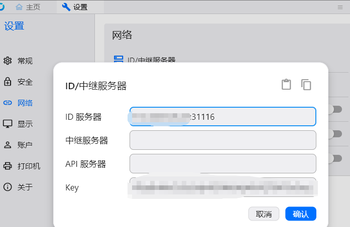

+++
date = '2026-06-21T16:45:12+08:00'
draft = false
title = '自建rustdesk'

+++

## 服务器端配置

1：服务端rustdesk-serv，直接去github根据vps系统下载好对应的文件，给好权限，用systemd方式运行比较稳定，debian配置如下

#### 1. 创建 hbbs 服务文件

```
sudo nano /etc/systemd/system/rustdesk-hbbs.service
```

粘贴以下内容（**根据你的实际路径修改**），默认是21118端口，这里是修改自定义端口版本：

```
[Unit]
Description=RustDesk ID/Rendezvous Server (hbbs)
After=network-online.target
Wants=network-online.target

[Service]
Type=simple
User=root
WorkingDirectory=/etc/rustdest
ExecStart=/etc/rustdest/hbbs -p 31116 -r vps-ip或域名:31117
Restart=always
RestartSec=5s
LimitNOFILE=65535
MemoryMax=512M

[Install]
WantedBy=multi-user.target
```

#### 2. 创建 hbbr 服务文件

```
sudo nano /etc/systemd/system/rustdesk-hbbr.service
```

粘贴以下内容：

```
[Unit]
Description=RustDesk Relay Server (hbbr)
After=network-online.target
Wants=network-online.target

[Service]
Type=simple
User=root
WorkingDirectory=/etc/rustdest
ExecStart=/etc/rustdest/hbbr -p 31117
Restart=always
RestartSec=5s
LimitNOFILE=65535

[Install]
WantedBy=multi-user.target
```

#### 3，将创建好的文件移动到

mv /etc/rustdest/rustdesk-hbbs.service /etc/systemd/system/

mv /etc/rustdest/rustdesk-hbbr.service /etc/systemd/system/

\# 启用并立即启动

 sudo systemctl enable --now rustdesk-hbbs 

sudo systemctl enable --now rustdesk-hbbr

\# 查看状态（重要！） 

systemctl status rustdesk-hbbs 

systemctl status rustdesk-hbbr

#如有修改

systemctl daemon-reload

systemctl restart rustdesk-hbbs
systemctl restart rustdesk-hbbr

systemctl status rustdesk-hbbs --no-pager
systemctl status rustdesk-hbbr --no-pager

检查端口：

```
ss -lnptu | grep hbbs
```

如果配置生效，你应该看到：

```
31115
31116
31117
31118
31119
```

而不再是默认的：

```
21115
21116
21117
21118
21119
```

| 服务           | 端口          | 状态 |
| -------------- | ------------- | ---- |
| hbbs NAT测试   | 31115/TCP     | ✅    |
| hbbs 主服务    | 31116/TCP+UDP | ✅    |
| hbbs WebSocket | 31118/TCP     | ✅    |
| hbbr Relay     | 31117/TCP     | ✅    |
| hbbr WebSocket | 31119/TCP     | ✅    |

至此，服务器端配置完毕。

### Key（公钥）怎么查看？

在你的 RustDesk 目录（/etc/rustdest/）执行：

```
cat /etc/rustdest/id_ed25519.pub
```

或者：

```
sudo cat /etc/rustdest/id_ed25519.pub
```

**输出示例**：

```
4TqvBrMuOtJ2a3dy4GKWrbKyKkVQT9AF5oSeyLbCiMQ=
```

把**整行内容**复制到 Windows 客户端的 **设置 → 网络 → Key** 中。

备份的时候，直接把整个目录打包，以后需要还原直接解压就行，这样key可以保留，如果不保留，每次运行也会自动生成新key

------

### 客户端配置

直接到github下载rustdesk（注意不带server）

### Windows 客户端配置

RustDesk：

**设置 → 网络**

填写：

```
ID服务器(ID Server)
ip或域名:31116

中继服务器(Relay Server)#如果vps很烂，这里最好也留空，这样连上后会优先走p2p直连
ip或域名:31117

API服务器(API Server)
留空
```

然后填写 Key：

```
your key
```

保存即可。


